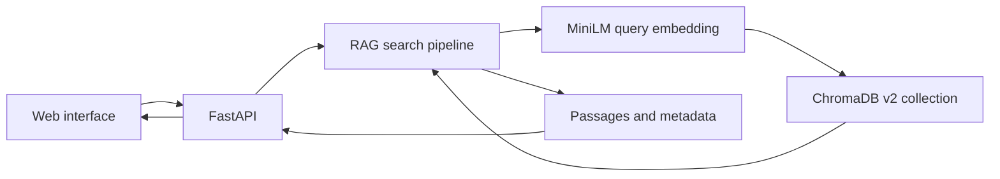

# Nyay AI

Nyay AI is a local semantic search and legal-research application for Indian Supreme Court judgments. It retrieves passages from an existing ChromaDB corpus and compares those passages with a user-supplied case summary. It does not use a generative language model.

**Nyay AI is not legal advice or legal analysis.** Verify every authority and consult a qualified lawyer.

## Features

- Semantic retrieval over `nyaai_judgments_v2`
- Duplicate and near-duplicate passage removal
- Source metadata for document, chunk, and page references
- Configurable top-k retrieval
- Semantic retrieval API and deterministic case-to-precedent comparison
- No generative model, external AI provider, or AI API credentials
- Basic email/password signup and login with salted password hashes and expiring HTTP-only sessions
- Professional responsive web interface
- Grouped, bullet-point case results with available decision date, pages, sources, technical score, and selected verbatim passage highlights
- Chatbot follow-ups can target one explicitly selected or named case (Case A–E), retain recent question context, and show question-ranked excerpts with page and chunk citations
- Comparison and evidence-review prompts use retrieval and exact keyword overlap; they do not generate arguments or confirm evidence gaps
- Copy-case-bullets and copy-source-reference actions
- On-demand comparison of case facts with retrieved judgment passages; lawyer review is required
- Read-only retrieval evaluation

## Architecture



## Repository layout

```text
app/                 FastAPI backend and static frontend
rag/                 PDF, chunking, embedding, ingestion, and retrieval modules
scripts/             Dataset and retrieval utilities
tests/               Automated tests
data/chroma/         Existing persistent ChromaDB data
data/raw/            Source PDFs (not committed)
evaluation/          Retrieval evaluation reports
```

## Existing corpus

The production collection is `nyaai_judgments_v2`:

- approximately 314,870 indexed chunks
- embedding model: `sentence-transformers/all-MiniLM-L6-v2`
- embedding dimensions: 384
- chunks: approximately 700 words
- overlap: 100 words
- top-k: configurable, default 5

The legacy `nyaai_judgments` collection remains available and untouched. Existing PDF, ChromaDB, and ingestion files must not be recreated or deleted for normal application use.

## Installation

Requires Python 3.12 on Windows.

```powershell
python -m venv .venv
.\\.venv\\Scripts\\Activate.ps1
python -m pip install -r requirements.txt
Copy-Item .env.example .env
```

Search requires no API key or generative model. The local embedding model and ChromaDB collection may need to be downloaded or initialized the first time they are run.

On the first visit, create an account or log in. Accounts are stored in a local SQLite database at `data/auth.sqlite3`; passwords are stored as salted scrypt hashes. The database is ignored by Git. This basic authentication does not include email verification or password recovery.

Enter a short case summary or legal issue in the web interface. Retrieved passages are grouped by judgment and presented as case cards with page references and excerpts. Case analysis compares exact keywords in the supplied summary with passages retrieved from the selected judgments and surfaces general questions for counsel. It does not generate arguments, determine legal applicability, or identify confirmed evidence gaps. Keyword overlap is not proof of factual or legal similarity; review complete judgments and consult qualified counsel.

## Run locally

```powershell
.\\.venv\\Scripts\\python.exe -m uvicorn app.main:app --host 127.0.0.1 --port 8000
```

Open `http://127.0.0.1:8000`.

API documentation is available at `http://127.0.0.1:8000/docs`.

## Deploy a free demo on Render

The repository includes a Render Blueprint in `render.yaml`. Push the project to GitHub, create a new Blueprint from the repository in Render, and deploy the `nyayai-demo` web service. The service uses the lightweight `requirements-render.txt` dependencies and reports when the judgment corpus is missing.

The local ChromaDB corpus is not stored in Git and is approximately 6.9 GB. Render's free web services use ephemeral storage and cannot attach persistent disks, so this free demo serves the UI but cannot return case-search results. The local SQLite account database is also ephemeral on Render's free tier; accounts may be lost when the service restarts or redeploys. Set `AUTH_DB_PATH` to a mounted persistent disk path on a paid service if account persistence is required. A full search deployment also needs a persistent disk or an external vector database and a separate data transfer/migration.

## Environment variables

| Variable | Default | Purpose |
|---|---|---|
| `CHROMA_DIR` | `./data/chroma` | Persistent ChromaDB directory |
| `COLLECTION_NAME` | `nyaai_judgments_v2` | Default collection |
| `INGESTION_COLLECTION_NAME` | `nyaai_judgments_v2` | Production collection |
| `EMBEDDING_MODEL` | MiniLM L6 v2 | Query and document embedding model |
| `TOP_K` | `5` | Default retrieval count |
| `CORS_ORIGINS` | local URLs | Allowed frontend origins |
| `AUTH_DB_PATH` | `./data/auth.sqlite3` | SQLite database for user accounts and sessions |

## API

| Method | Endpoint | Purpose |
|---|---|---|
| `GET` | `/api/health` | Collection and process health |
| `POST` | `/api/auth/signup` | Create an account and sign in |
| `POST` | `/api/auth/login` | Sign in |
| `POST` | `/api/auth/logout` | Sign out |
| `GET` | `/api/auth/me` | Check the current session |
| `GET` | `/api/status` | Retrieval configuration |
| `POST` | `/api/retrieve` | Retrieval-only debugging |
| `POST` | `/api/query` | Semantic judgment search with source passages |
| `POST` | `/api/analyze-case` | Retrieval-only comparison of a case summary with selected judgment passages |
| `GET` | `/api/documents/{chunk_id}` | Retrieve one chunk and metadata |

Example retrieval:

```powershell
Invoke-RestMethod -Method Post -Uri "http://127.0.0.1:8000/api/query" -ContentType "application/json" -Body '{"query":"How does Article 21 protect personal liberty?","top_k":5}'
```

## Search CLI

```powershell
python -m rag.search
python -m rag.search --collection nyaai_judgments
```

## Retrieval evaluation

The evaluation command is read-only and does not modify ChromaDB or re-ingest documents:

```powershell
python -m scripts.evaluate_retrieval --top-k 5 --output evaluation/retrieval_evaluation.json
```

The suite covers basic structure, Articles 13/368/19/21, circumstantial evidence, presumption of innocence, dying declarations, burden of proof, contractual coercion, frustration, and natural justice topics as available.

The report contains latency, candidate counts, duplicate removal counts, document diversity, metadata completeness, and lexical overlap diagnostics. Lexical overlap and retrieval similarity are not legal relevance labels or correctness measurements. Precision, Recall, and MRR require a manually labeled relevance dataset and are not fabricated here.

## Ingestion

Normal application use does not ingest data. Existing ingestion remains resumable and safe:

```powershell
python -m rag.ingest --dry-run --resume --limit 1000
python -m rag.ingest --limit 500 --resume
```

Do not run ingestion against the production collection merely to test application changes.

## Testing

```powershell
.\\.venv\\Scripts\\python.exe -m pytest -q
```

Tests use mocks and temporary Chroma collections. They do not write to the production collection.

## Security and limitations

- The application does not use external LLM APIs or API credentials.
- `.env` and local databases are excluded from Git.
- The corpus does not represent every Indian judgment or statute.
- Metadata extraction is filename/page based until richer judgment metadata is available.
- The system does not generate legal analysis or legal conclusions.
- It does not automatically identify evidence gaps, applicable statutes, or all relevant authorities.
- Retrieval similarity is not legal relevance or confidence.
- OCR is not attempted for image-only PDFs.
